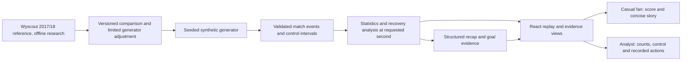

# Hackathon submission draft

Status: **working product demo; submission not yet complete**. Model-backed AI
verification from our backend and public delivery are still pending. Recovery
explanation code now exists locally with provider mocks; GPT-5 mini was tested
separately in the Foundry playground. See [integration status](foundry-explanations.md).
This document describes current
functionality and must be updated after those steps are verified.

## Deadline and mandatory deliverables

[Microsoft's official rules](https://github.com/microsoft/insidethegamehackathon/blob/main/OFFICIAL%20RULES.md)
set the submission deadline to **27 October 2026, 23:59 Pacific Time**. This is
**28 October 2026, 00:59 America/Mexico_City**. The official rules control if amended.
Submission requires a project description, a functioning demo/test build, a
**public GitHub repository** and a public demonstration video **shorter than two
minutes**, submitted through the registered participant's project portal.

## Current pitch — factual draft

Football Intelligence Lab turns synthetic football events into inspectable match
stories. Fans follow the score, goals and a concise summary; analysts explore
passing, controlled-ball time and recovery sequences behind the same observations.
Every view follows the replay clock, so rewinding removes future evidence. Final
recaps link goals to their recorded events. Reproducible synthetic scenarios test
both highlighted patterns and counterexamples. A historical Premier League
reference informs a limited generator adjustment, with remaining differences
reported openly.

Current stack: React, TypeScript, Vite, Tailwind, FastAPI, Pydantic, GitHub and
Vercel. Narration currently uses deterministic templates. Add a factual description
of Microsoft/AI services only after the integration has been exercised successfully.
Do not label the current templates as model-generated AI.

## Proposed demo — target 110 seconds

This version demonstrates the current product. Add the actual AI interaction after
implementation, shortening other scenes to stay under two minutes.

| Time | Show | Explain |
| --- | --- | --- |
| 0–10s | Replay, synthetic-data notice | “A score tells us the result. We want to inspect the events behind the story.” |
| 10–25s | More high recoveries; seek 19:58, 1×, Play | The card appears after 20:00, once the comparison window closes. |
| 25–40s | Recovery increase 1→6 and supporting possession | Three later-window recoveries reached shots. Open the evidence instead of inferring tactics. |
| 40–55s | Switch Casual fan → Analyst | Same facts, with plain-language summary versus passing/control details and recorded actions. Clock stays unchanged. |
| 55–75s | Circulation vs counterattack at 90:00 | The higher-control team has fewer shots and loses 0–2. Possession alone does not establish superiority. |
| 75–90s | Final summary; select first goal | Goal evidence navigates to that instant. The later goal disappears from the summary. |
| 90–100s | Switch EN/ES; briefly show mobile layout | Audience and language are independent preferences. |
| 100–110s | Architecture and closing | Calculations supply facts; future AI explanations must remain grounded in those facts. |

Record the real local or published application. Use the final verified deployment
for a submitted recording where possible. Do not present planned features as working.
Keep the recording below 2:00 including title/end cards.

## Architecture, as implemented

No live external feed or deployed model inference is represented in this diagram.
Wyscout records support offline research; the public replay consumes synthetic data.

## Delivery checklist

- [x] Reproducible synthetic match and regression scenarios.
- [x] Temporal statistics, recovery evidence and replay controls.
- [x] Historical reference comparison with limitations.
- [x] Casual fan/analyst modes and EN/ES.
- [x] Time-bounded summary, final recap and clickable goal evidence.
- [ ] Model-backed explanations grounded in the structured facts.
- [ ] Confirm applicable category and actual Microsoft technology integration.
- [ ] Update pitch/architecture to match that integration and its limits.
- [ ] Commit/push approved changes; verify both frontend/API deployments.
- [ ] Public repository suitable for judging, with attribution and clear setup steps.
- [ ] Working public demo verified at the submitted URLs.
- [ ] Record/upload a public demo video shorter than two minutes.
- [ ] Complete and submit every required portal field; confirm submission receipt.

Changing repository visibility, pushing and deploying remain actions requiring the
user's specific authorization. A public repository and delivery links have not been
created by this checklist.
