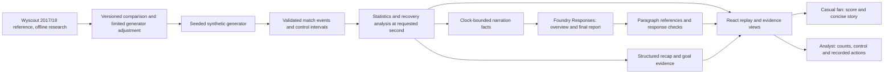

# Hackathon submission draft

Status: **working product demo; submission not yet complete**. Model-backed AI
evaluation across scenarios/languages and public delivery are still pending. Recovery
explanation code has provider mocks; the user also completed one real local call
through the app and backend to GPT-5 mini. See [integration status](foundry-explanations.md).
This document describes current
functionality and must be updated after those steps are verified.

## Deadline and mandatory deliverables

[Microsoft's official rules](https://github.com/microsoft/insidethegamehackathon/blob/main/OFFICIAL%20RULES.md)
set the submission deadline to **27 October 2026, 23:59 Pacific Time**. This is
**28 October 2026, 00:59 America/Mexico_City**. The official rules control if amended.
Submission requires a project description, a functioning demo/test build, a
**public GitHub repository** and a public demonstration video **shorter than two
minutes**, submitted through the registered participant's project portal.

## Current pitch — factual draft

Football Intelligence Lab turns synthetic football events into inspectable match
stories. A whole-match AI card explains the current clock and requests a final
report at full time after activation. Fans receive a concise two-paragraph story;
analysts receive three paragraphs with passing, control and recent shot activity.
Each paragraph cites calculated facts. Users request an exact instant or opt into
updates at goals and time checkpoints. The new general narration still needs a
real-provider check; the recovery explanation has one verified real local call.
Fans also follow the score, goals and a calculated summary; analysts explore
passing, controlled-ball time and recovery sequences behind the same observations.
Every view follows the replay clock, so rewinding removes future evidence. Final
recaps link goals to their recorded events. Reproducible synthetic scenarios test
both highlighted patterns and counterexamples. A historical Premier League
reference informs a limited generator adjustment, with remaining differences
reported openly.

Current stack: React, TypeScript, Vite, Tailwind, FastAPI, Pydantic, GitHub and
Vercel, with a Microsoft Foundry Responses adapter for recovery explanations,
whole-match narration and final reports. Calculated companion summaries use
deterministic templates. Verify the new general/final prompts with the real model
before including them as demonstrated functionality in the submitted pitch/video.

## Proposed demo — target 110 seconds

Record this version after verifying general/final narration with the real model.
Prepare responses in advance if needed and keep their evidence clocks visible;
do not imply latency or successful calls that were not observed.

| Time | Show | Explain |
| --- | --- | --- |
| 0–10s | Replay, synthetic-data notice | “A score tells us the result. We want to inspect the events behind the story.” |
| 10–28s | Whole-match AI at a chosen clock, open paragraph references | The model receives score, shots, passing, control and recorded moments only through this cutoff. |
| 28–43s | Fan/analyst and EN/ES versions already verified | Two concise paragraphs versus three precise paragraphs using the same evidence. |
| 43–60s | Recovery increase 1→6 and supporting possession | Three later-window recoveries reached shots. Inspect recorded evidence. |
| 60–82s | Original scenario at 90:00 with the AI final report | Home–away score is 0–2. Compare controlled time and shots without inventing causes. |
| 82–98s | Select first goal; rewind before a generated cutoff | Later goals and future AI text disappear. |
| 98–110s | Architecture, mobile and closing | Python computes the facts, Foundry writes cited explanations, React synchronizes the view. |

Record the real local or published application. Use the final verified deployment
for a submitted recording where possible. Do not present planned features as working.
Keep the recording below 2:00 including title/end cards.

## Architecture, as implemented

The inference adapter is implemented locally; production inference remains unverified.
There is no live external feed.
Wyscout records support offline research; the public replay consumes synthetic data.

## Delivery checklist

- [x] Reproducible synthetic match and regression scenarios.
- [x] Temporal statistics, recovery evidence and replay controls.
- [x] Historical reference comparison with limitations.
- [x] Casual fan/analyst modes and EN/ES.
- [x] Time-bounded summary, final recap and clickable goal evidence.
- [x] General/final AI adapter, paragraph citations, audience instructions and optional checkpoint updates implemented and tested with provider mocks.
- [x] One real local recovery explanation matches its calculated facts.
- [ ] Verify new general/final narration with real Azure in EN/ES and both audiences.
- [ ] Confirm applicable category and actual Microsoft technology integration.
- [ ] Update pitch/architecture to match that integration and its limits.
- [ ] Commit/push approved changes; verify both frontend/API deployments.
- [ ] Public repository suitable for judging, with attribution and clear setup steps.
- [ ] Working public demo verified at the submitted URLs.
- [ ] Record/upload a public demo video shorter than two minutes.
- [ ] Complete and submit every required portal field; confirm submission receipt.

Changing repository visibility, pushing and deploying remain actions requiring the
user's specific authorization. A public repository and delivery links have not been
created by this checklist.
